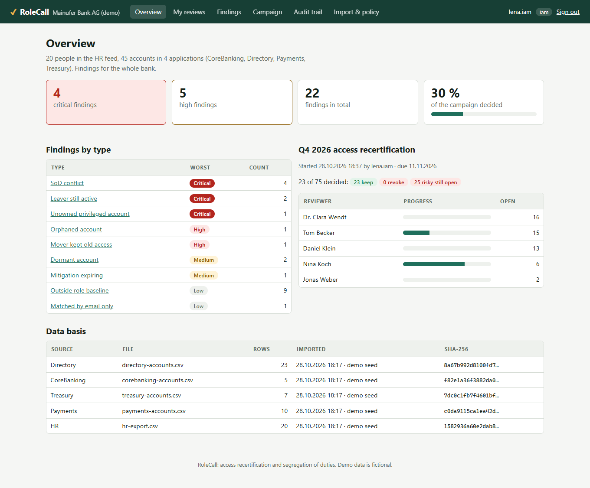
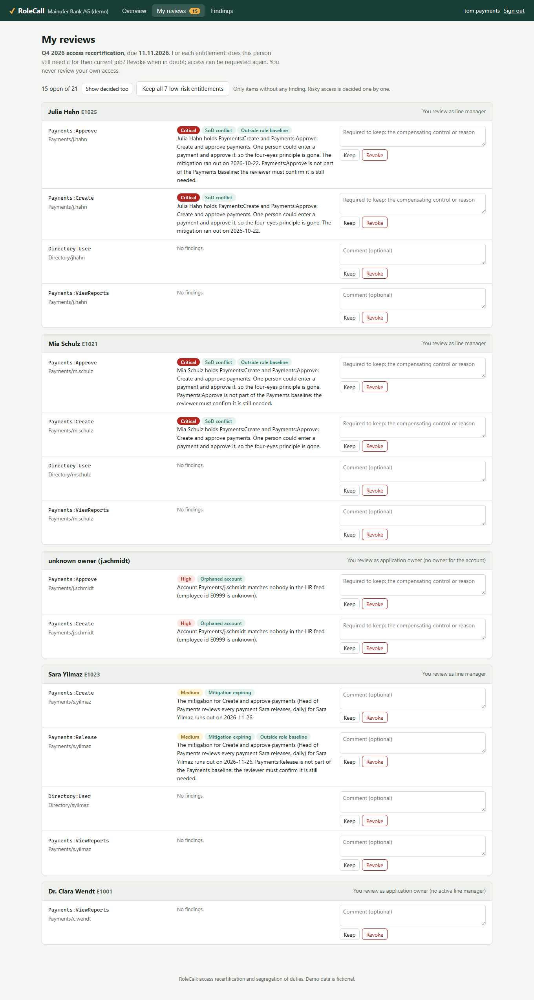
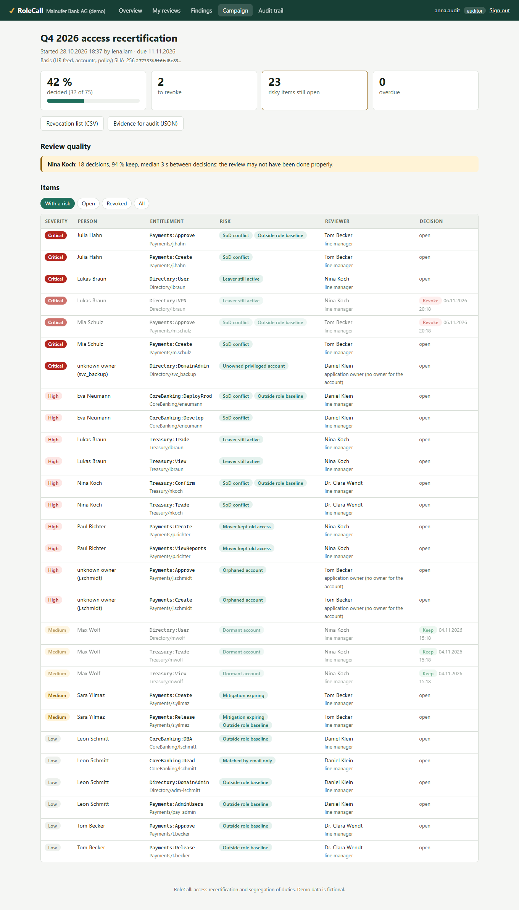
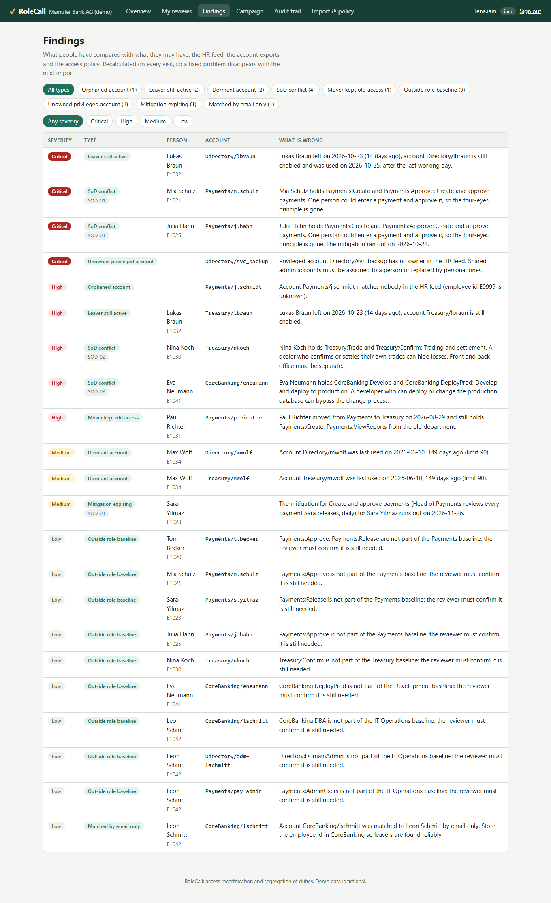
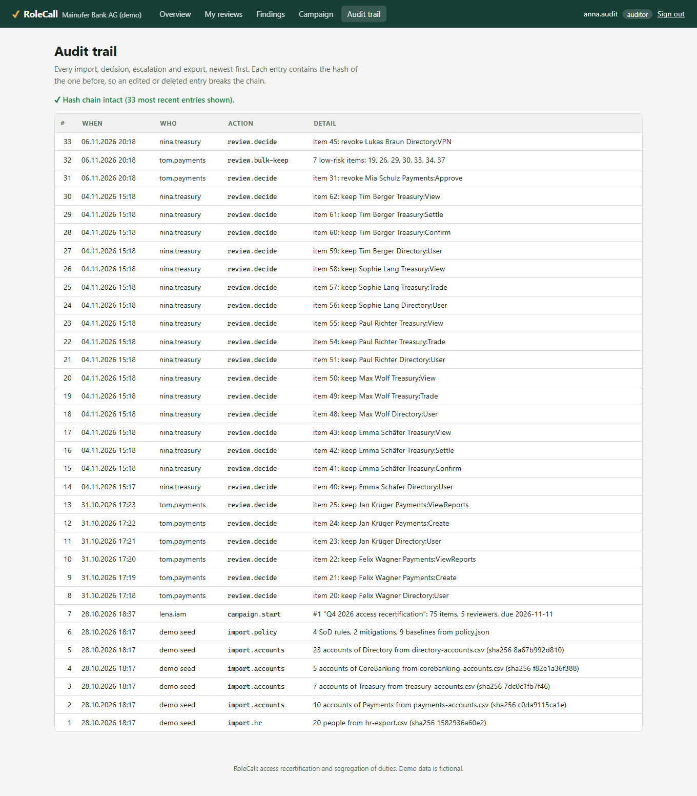

# RoleCall

**Access recertification and segregation of duties for banks, in ASP.NET Core 10 Razor Pages: compare the HR feed with the
account exports of every application, find what should not be there, and let each manager confirm or revoke their
people's access, with rules that stop a review from being clicked through.**



> 🇩🇪 **Kurzbeschreibung:** RoleCall unterstützt die regelmäßige Rezertifizierung von Zugriffsrechten, wie sie Banken
> nach DORA und MaRisk durchführen müssen. Der HR-Abzug wird mit den Benutzerkonten aller Anwendungen abgeglichen:
> verwaiste Konten, ausgeschiedene Mitarbeitende mit aktivem Zugang, ungenutzte Konten, Verstöße gegen die
> Funktionstrennung (auch über Anwendungen hinweg, z. B. Zahlung erfassen und freigeben) und Rechte, die nach einem
> Abteilungswechsel geblieben sind. In einer Kampagne entscheidet die Führungskraft je Berechtigung „behalten“ oder
> „entziehen“. Niemand prüft die eigenen Rechte, riskante Rechte brauchen eine Begründung, und durchgeklickte Prüfungen
> werden der Revision angezeigt. Ergebnis: eine Entzugsliste für die Administratoren und ein Prüfnachweis mit SHA-256.

---

## Why this project

Every bank has to prove, regularly, that people only have the access their job needs. DORA asks for policies that limit
logical access to what is required for approved functions (Regulation (EU) 2022/2554, Art. 9(4)(c)), its technical
standard on ICT risk management spells out identity management and access control, ISO/IEC 27001 has the same in
controls 5.15 to 5.18, and German banks have long known it from MaRisk, where segregation of duties goes as far as
separating trading from settlement (BTO 2.1).

In practice this often means a spreadsheet per manager once a quarter, and three things go wrong:

1. **Leavers keep their access.** HR records the last working day; the VPN account still works two weeks later.
2. **Toxic combinations go unnoticed** because they live in different systems: a user administrator in the directory
   who can also approve payments in another application.
3. **The review is rubber-stamped.** 40 lines, "keep all", 30 seconds.

RoleCall finds the first two automatically and makes the third visible.

## What it does

| | How | Where |
|---|---|---|
| **Match accounts to people** | By employee id, otherwise by email (only if unique), and says when it fell back to email | [`Analyzer.Match`](src/RoleCall.Domain/Analysis/Analyzer.cs) |
| **Orphaned accounts** | No matching person in the HR feed; a privileged one without owner is critical (shared admin) | [`Analyzer`](src/RoleCall.Domain/Analysis/Analyzer.cs) |
| **Leavers still active** | Enabled after the last working day plus a grace day; no grace for privileged accounts; critical if the account was **used** after leaving | [`Analyzer`](src/RoleCall.Domain/Analysis/Analyzer.cs) |
| **Dormant accounts** | No login for 90 days (configurable), or never used | [`Analyzer`](src/RoleCall.Domain/Analysis/Analyzer.cs) |
| **Segregation of duties** | Rules with two sides (any of A **and** any of B), checked across all applications of a person; accepted conflicts need a mitigation with an expiry date | [`Analyzer`](src/RoleCall.Domain/Analysis/Analyzer.cs), [`policy.json`](src/RoleCall.Web/Data/Seed/policy.json) |
| **Movers** | Access of the old department still there after the 30-day handover | [`Analyzer`](src/RoleCall.Domain/Analysis/Analyzer.cs) |
| **Role baselines** | Access outside the department's birthright set must be confirmed by the reviewer | [`Analyzer`](src/RoleCall.Domain/Analysis/Analyzer.cs) |
| **Reviewer assignment** | Line manager; without an active manager, or for orphaned accounts, the application owner; **never the person themselves**, then the fallback reviewer (CISO) | [`CampaignPlanner.Reviewer`](src/RoleCall.Domain/Reviews/Campaign.cs) |
| **Decision rules** | Leaver access can only be revoked; keeping an SoD conflict, an orphaned account or a mover's old access needs a written reason; "keep all" only for items without any finding | [`ReviewRules`](src/RoleCall.Domain/Reviews/Campaign.cs) |
| **Rubber-stamping signal** | 10 or more decisions, at least 90 % keep, median under 4 s apart: shown to internal audit | [`RubberStamp`](src/RoleCall.Domain/Reviews/Campaign.cs) |
| **Escalation** | After the due date, open items move to the reviewer's own manager (never to the subject) | [`EscalateOverdueAsync`](src/RoleCall.Web/Services/ReviewService.cs) |
| **Evidence** | Every import logged with its SHA-256; the campaign stores a hash of its basis; the audit trail is a hash chain; exports carry `X-Content-SHA256` | [`ReviewService`](src/RoleCall.Web/Services/ReviewService.cs) |

## Quick start

```bash
git clone https://github.com/karicamar/role-call && cd role-call
dotnet run --project src/RoleCall.Web      # http://localhost:5095, a fictional bank with a campaign in progress
```

Sign in as one of the demo users (no passwords; this list only exists in the development configuration):

| User | Sees |
|---|---|
| **Lena** (IAM team) | everything; imports the feeds, starts, escalates and closes campaigns |
| **Tom** (Head of Payments) | reviews of the payments team: a clerk who can create *and* approve payments, an orphaned account |
| **Nina** (Head of Treasury) | a dealer who left 14 days ago and still logged in to the VPN after the last working day |
| **Daniel** (Head of IT), **Clara** (CEO), **Jonas** (CISO) | their own review items and escalations |
| **Anna** (internal audit) | the campaign, review-quality signals and the audit trail, read-only |

The demo data is created relative to today, so it always shows the same situation.

## Screens

| My reviews (Tom) | Campaign (internal audit) |
|---|---|
|  |  |

| Findings | Audit trail |
|---|---|
|  |  |

## Import format

**HR feed** (`employee_id, name, email, department, position, manager_id`, optional `leave_date, previous_department, moved_on`):

```csv
employee_id,name,email,department,position,manager_id,leave_date,previous_department,moved_on
E1021,Mia Schulz,mia.schulz@bank.example,Payments,Payments Clerk,E1020,,,
E1031,Paul Richter,paul.richter@bank.example,Treasury,Dealer,E1030,,Payments,2026-09-07
```

**Accounts of one application** (`account_id, enabled, entitlements`, optional `employee_id, email, privileged, created, last_login`):

```csv
account_id,employee_id,enabled,privileged,last_login,entitlements
m.schulz,E1021,yes,no,2026-11-05,Create|Approve|ViewReports
svc_backup,,yes,yes,2026-11-05,DomainAdmin
```

Comma or semicolon (German Excel), UTF-8 with or without BOM, dates as `2026-11-06` or `06.11.2026`, yes/no also as
ja/nein. Errors name the line. The **policy** is a JSON file the IAM team keeps in version control:
[`policy.json`](src/RoleCall.Web/Data/Seed/policy.json).

## Security

- **Authorization in two places:** page conventions (IAM team, oversight) and again in the service, so a hand-made request
  gets no further than a click. A manager sees findings only for their direct reports.
- **Sign-in:** OpenID Connect with PKCE against the bank's identity provider (Entra ID app roles `iam`, `auditor`; the
  employee-id claim links the user to the HR feed). The passwordless demo login exists only when `RoleCall:DemoLogin` is set.
- **Cookies** HttpOnly, SameSite=Strict, Secure; **antiforgery** tokens on every form, including sign-out (minimal APIs
  only check them when they bind a form, so sign-out validates explicitly); local-only return URLs.
- **Content Security Policy** `default-src 'none'`: the app has no JavaScript at all; styles only from its own stylesheet.
  `no-store` caching, `nosniff`, `no-referrer`, `frame-ancestors 'none'`.
- **CSV injection:** exported fields starting with `= + - @` are prefixed, so Excel shows them as text.
- **Uploads:** size, row and field-length limits, strict UTF-8, file names stripped of paths and control characters.
- **Optimistic concurrency** on every review item: two tabs cannot overwrite each other's decision.
- **Tamper-evident audit trail:** each entry hashes the previous one; the audit page verifies the chain.

## Tests

```bash
dotnet test        # 115 tests
```

- **Domain:** CSV edge cases and formula escaping, HR and account import errors, policy validation, every finding type
  with its boundary (grace days, 90 vs. 91 days, mitigations before and after expiry), reviewer assignment, decision rules,
  rubber-stamp detection.
- **Workflow** against SQLite with a fake clock: start, decide, stale versions, self-review blocked and logged, bulk keep,
  escalation, closing, exports, evidence hash, audit-chain tampering (edit and delete).
- **HTTP:** sign-in required everywhere, headers, cookie flags, open redirect, CSRF on login, decisions and sign-out,
  role checks, the manager's view, uploads.
- **Browser:** [`demo/screenshots.mjs`](demo/screenshots.mjs) drives headless Chrome through the whole story and fails on any
  console error, CSP violation or sideways scrolling on a phone. CI runs it on every push.

## Not modelled

Access requests and approvals (only the periodic review), automatic de-provisioning through SCIM or the applications' APIs
(the revocation list goes to the administrators), fine-grained permissions inside a role, and delegation of a review to a
deputy. The demo bank, its people and data are fictional.

## License

MIT
